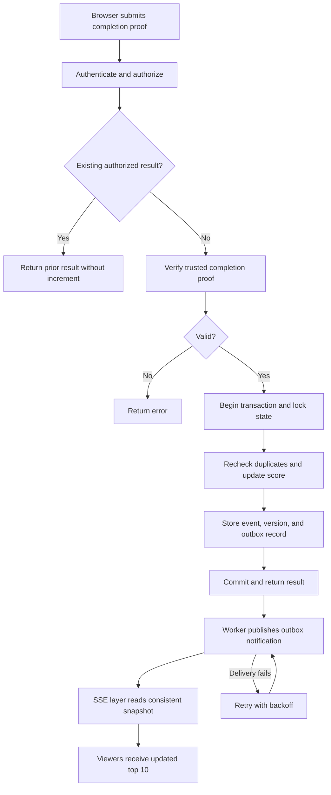

# Problem 6: Live Scoreboard API Specification

## 1. Purpose

Design a backend module that securely records score increases and delivers live updates to a website displaying the top 10 users.

This document defines the API contracts, data model, execution flow, security controls, and acceptance criteria for implementation.

## 2. Assumptions and Scope

- Each user starts with a score of zero.
- Scores increase by positive integer awards.
- A trusted action service verifies action completion and issues signed completion proofs. The action itself is outside this module's scope.
- Each completion has a globally unique identifier and can earn points only once.
- The browser submits completion evidence; it cannot choose the user receiving points or the award amount.
- Scoreboard reads and live subscriptions are public.
- Rankings use score descending, then immutable user ID ascending for deterministic ties.
- Display up to 10 users with accepted awards. Return fewer entries when fewer users qualify.
- Under normal operation, score changes should reach connected viewers within two seconds of database commit.

Proposed implementation: PostgreSQL for persistent storage, a transactional outbox for reliable notifications, and Server-Sent Events (SSE) for live delivery.

## 3. API Contracts

### 3.1 Submit an Action Completion

`POST /v1/score-events`

Required headers:

```http
Authorization: Bearer <access-token>
Idempotency-Key: <unique-request-key>
Content-Type: application/json
```

Request:

```json
{
  "completionId": "completion-456",
  "proof": "<signed-completion-proof>"
}
```

The API derives the user ID from the authenticated token and the award from the verified proof. Reject unknown request fields, including client-supplied scores or award amounts.

For a new award, return `201 Created`:

```json
{
  "eventId": "score-event-789",
  "completionId": "completion-456",
  "userId": "user-123",
  "awarded": 10,
  "scoreAfterAward": 120,
  "applied": true
}
```

`scoreAfterAward` is the user's total immediately after this event, not necessarily their current total when a response is replayed.

For an already accepted completion, return `200 OK` with the original event details and `applied: false`. Do not award points again.

Idempotency rules:

- Scope keys to the authenticated user.
- The same key and request fingerprint return the existing event result.
- The same key with a different fingerprint returns `409 Conflict`.
- A different key for an already accepted completion still returns the existing event result.
- Enforce completion uniqueness independently of idempotency keys.
- Authenticate and verify ownership before returning any existing event.
- A successful replay may return the stored result without revalidating an expired proof. New awards always require a currently valid proof.

### 3.2 Read the Scoreboard

`GET /v1/scoreboard`

Return up to 10 entries:

```json
{
  "version": "842",
  "entries": [
    {
      "rank": 1,
      "userId": "user-123",
      "displayName": "Ari",
      "score": 120
    }
  ]
}
```

Rules:

- Sort by `score DESC, user_id ASC`.
- Assign sequential ranks from 1 to 10.
- Read entries and version from one consistent database snapshot.
- Return only public user IDs, display names, and scores.
- Return an empty entries array when no awards exist.
- Serialize versions as decimal strings to avoid JavaScript integer overflow.

### 3.3 Subscribe to Live Updates

`GET /v1/scoreboard/stream`

Response headers:

```http
Content-Type: text/event-stream
Cache-Control: no-cache
```

Example event:

```text
id: 842
event: scoreboard
data: {"version":"842","entries":[{"rank":1,"userId":"user-123","displayName":"Ari","score":120}]}

```

Stream behavior:

- Register the subscription before reading its initial snapshot and buffer notifications during initialization.
- Send a complete initial snapshot.
- Process buffered notifications after initialization and fetch a fresh snapshot when a newer version is available.
- Send complete snapshots when leaderboard entries change.
- Send heartbeat comments every 15 seconds.
- Disable reverse-proxy buffering for this endpoint.
- On reconnect, send a fresh snapshot. Historical event replay is not required.
- Clients replace their displayed list with each newer snapshot and ignore older or equal versions.
- Version gaps are valid because some score changes do not affect the top 10.
- Reconcile each connection with the database at least every second so missed transport notifications cannot leave the scoreboard stale indefinitely.

## 4. Completion Verification and Authorization

The trusted action service must verify completion before issuing a signed proof. A browser statement or a server-issued challenge alone is insufficient evidence.

Required proof claims:

| Claim | Meaning |
| --- | --- |
| `iss` | Trusted action service |
| `aud` | Score API |
| `sub` | User receiving the award |
| `completionId` | Globally unique completed action instance |
| `award` | Positive integer points |
| `iat` | Issue time |
| `exp` | Expiration time |

For a new award, the API must:

1. Validate the access token, including signature, issuer, audience, and expiry.
2. Verify the proof using an allowlisted signing algorithm and trusted public key.
3. Validate the proof issuer, audience, timestamps, and required claims.
4. Confirm `sub` matches the authenticated user.
5. Confirm the proof's completion ID matches the request.
6. Validate the award against configured bounds and scoring rules.
7. Enforce persistent completion uniqueness.

Signing keys remain with the trusted issuer. Support key rotation through trusted key IDs; never accept arbitrary key URLs supplied by a proof.

## 5. Data Model

### UserScore

| Field | Constraint / purpose |
| --- | --- |
| `user_id` | Primary key |
| `score` | Non-negative integer total |
| `updated_at` | Last accepted award time |

Create an index on `(score DESC, user_id ASC)` for top-10 queries.

### ScoreEvent

| Field | Constraint / purpose |
| --- | --- |
| `event_id` | Primary key |
| `completion_id` | Unique; prevents repeated awards |
| `user_id` | Award recipient |
| `award` | Positive integer |
| `score_after_award` | Total immediately after this event |
| `created_at` | Audit timestamp |

### IdempotencyRecord

| Field | Constraint / purpose |
| --- | --- |
| `user_id` | Authenticated caller |
| `idempotency_key` | Caller-generated request key |
| `request_fingerprint` | Hash of canonical request content |
| `event_id` | Accepted score event |

Enforce uniqueness on `(user_id, idempotency_key)`.

### ScoreboardState

A singleton record containing a monotonic `version`, initially zero.

### OutboxEvent

| Field | Constraint / purpose |
| --- | --- |
| `id` | Primary key |
| `version` | Committed scoreboard version |
| `created_at` | Creation time |
| `published_at` | Null until successfully published |
| `attempts` | Delivery attempt count |

Use database integers with explicit overflow checks. For this specification, score totals must not exceed `Number.MAX_SAFE_INTEGER`; reject an award that would exceed that bound.

## 6. Atomic Score Update

After authentication and proof verification:

1. Begin a database transaction.
2. Lock the singleton scoreboard-state row.
3. Check the user's idempotency record.
   - If the fingerprint differs, return a conflict.
   - If it matches, return the existing event without another increment.
4. Check whether the completion already has a score event.
   - If it belongs to this user, associate the new idempotency key and return the existing event.
   - Otherwise, reject the request.
5. Create the user's score row if necessary.
6. Validate the resulting total and increment it atomically.
7. Insert the score event and idempotency record.
8. Increment the scoreboard version.
9. Insert an outbox event containing that version.
10. Commit and return the accepted event.

Any failure before commit rolls back all changes.

The global lock provides simple, consistent version ordering for an initial implementation. Database unique constraints remain mandatory as a final safeguard.

All score-changing paths must follow this transaction protocol.

## 7: Concurrency Control

- Apply score updates within a database transaction.
- Use atomic increments to prevent lost updates.
- Enforce a unique constraint on completion_id to prevent duplicate awards.
- Enforce uniqueness on (user_id, idempotency_key).
- Lock the scoreboard-state row before checking duplicates and updating scores.
- Acquire locks in the same order across all score-writing paths.
- Insert the score event, score update, version increment, and outbox
  record in the same transaction.
- Retry transient deadlocks or serialization failures with bounded retries.
- Return success only after the transaction commits.

The initial design serializes writes through the scoreboard-state lock.
If throughput becomes a bottleneck, replace the global lock with per-user
locking and an ordered leaderboard projection.

## 8. Reliable Live Delivery

An outbox worker processes committed, unpublished records:

1. Claim an outbox record using a recoverable lease.
2. Publish a change notification to the live-delivery layer.
3. Mark it published only after successful acknowledgment.
4. Retry failures with exponential backoff and bounded delay.
5. Alert operators when delivery repeatedly fails.

A crash after publishing but before marking success may produce duplicate notifications. Consumers must tolerate duplicates.

Notifications indicate that the scoreboard may have changed. The live-delivery layer reads the current top 10 and version from a consistent snapshot; it must not attach an old outbox version to newer scoreboard data.

For multiple API instances, use a shared transport that broadcasts notifications to every instance hosting SSE clients. A competing-consumer queue alone does not provide this broadcast behavior.

Periodic database reconciliation provides recovery from missed notifications.

## 9. Execution Flow



Duplicate checks inside the transaction handle requests that race after the initial lookup. Notifications and periodic reconciliation both trigger snapshot refreshes.

## 10. Errors and Abuse Controls

Use a consistent error format:

```json
{
  "error": {
    "code": "INVALID_PROOF",
    "message": "Completion proof is invalid or expired."
  }
}
```

| HTTP status | Meaning |
| --- | --- |
| `400` | Malformed request, missing idempotency key, or unknown fields |
| `401` | Missing or invalid access token |
| `403` | Caller is not authorized for the completion |
| `409` | Idempotency key reused with different request content |
| `422` | Invalid proof, invalid award, or score overflow |
| `429` | Rate limit exceeded |
| `503` | Temporary dependency failure; retry with the same key |

Additional controls:

- Require HTTPS.
- Apply configurable per-user and per-IP write limits.
- Return `Retry-After` with rate-limit responses.
- Bound request sizes, proof sizes, and SSE connection counts.
- Never log access tokens or complete proofs.
- Audit accepted awards and rejection reason codes.
- Alert on unusual award rates and repeated invalid proofs.
- Apply an explicit browser-origin policy.
- Do not expose another user's event details in errors.

Rate limiting supplements completion verification; it does not establish that an action was legitimate.

## 11. Acceptance Criteria

1. A valid completion increases the correct user's score by the trusted award.
2. Missing authentication, forged proofs, expired proofs, and mismatched ownership are rejected.
3. Concurrent requests for the same completion produce exactly one award.
4. Concurrent valid completions for one user do not lose increments.
5. Reusing an idempotency key with different content returns a conflict.
6. A transaction failure leaves no partial score, event, or outbox changes.
7. The scoreboard returns at most 10 users in deterministic order.
8. Scoreboard entries and version represent the same database snapshot.
9. Connected viewers receive changes within two seconds under normal operation.
10. Reconnecting viewers receive a current snapshot.
11. Worker restarts and duplicate notifications do not corrupt scores.
12. An event committed during SSE initialization is eventually reflected in the stream.
13. Missed transport notifications are recovered through periodic reconciliation.

## 12. Operational Requirements

Monitor:

- Score-update latency and rejection rates.
- Database transaction latency and lock contention.
- Outbox backlog, retry counts, and oldest pending record age.
- Active SSE connections and delivery latency.

Provide health checks, graceful shutdown, database backups, and restoration procedures.

For the initial implementation, retain accepted events and idempotency records. Define archival and retention policies before introducing deletion; completion uniqueness must remain enforceable.

## 13. Improvements and Tradeoffs

### Reduce Global Lock Contention

The singleton version lock serializes score writes. This is a deliberate simplicity tradeoff for the initial implementation. If measured throughput requires it, introduce an ordered leaderboard projection with its own publication version.

### Add a Cached Ranking Projection

Start with indexed database queries. At larger scale, consider a Redis sorted set or a cached top-10 projection. Preserve deterministic ties, version consistency, and recovery from persistent score events.

### Coalesce Notifications

Combine bursts of changes into a single snapshot refresh while preserving the freshness target.

### Add Administrative Corrections

Support audited compensating adjustment events for abuse recovery. Restrict this capability to authorized administrators.

### Review Product Policies

Confirm award bounds, expected traffic, public identity fields, retention requirements, and whether seasonal scoreboards are needed. These policies may evolve without allowing browser-controlled awards.